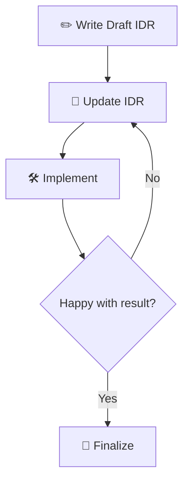

# idr-tools

[Proposal culture](https://wrla.ch/log/2026/08/writing-the-docs-2026-edition/) for the modern era. Moving from prompt-and-pray to proposal-driven development.

## Problem statement

This project came about due to finding the interaction loop of conventional AI systems (Claude, Copilot, etc.) slow and frustrating. You've seen it before:

Write a one line prompt describing roughly what you want -> LLM takes 5-15 minutes writing some stuff using some best guess of what was meant -> Don't get what you want, prompt it to change a bunch of stuff -> Repeat endlessly, feel sad

## A better way

The defacto solution to the above problem is agent skills and hooks. These *are* useful, but at least most of them only solve the "how to do something" part, rather than ensuring what is eventually produced is what we want.

IDRs are an attempt to distill a better way of working that I initially discovered while at Mozilla in the 2010s and later evangelized to anyone who would listen. In brief: put a design in writing using an easy-to-fill-in template, get feedback, implement. Often, you would write the implementation along with the doc, with the knowledge that it might change. The friction of discussing a written proposal shakes out any undiscovered assumptions and helps build consensus around an idea. The end result is almost always far better.

What I realized is that the same format can be an ideal guide to working with LLMs. A well-written design doc provides clearer guardrails to influence LLM behaviour and the end result is easier to understand and more reviewable. The change becomes a consensus between the human and the model, rather than the human simply signing off on model-produced code.



The best way to understand this workflow is just to try it. If you have [uv](https://docs.astral.sh/uv/) installed, you can run:

```sh
uvx --from idr-tools idr new "My fantastic idea"
```

If you don't have uv installed, you can run a simulacrum of the creation workflow via:

```sh
FILENAME="my-fantastic-idea.md"; TITLE="My fantastic idea"; OUTFILE="$(date -u +%Y%m%d%H%M)-$FILENAME"; \
curl -sL https://raw.githubusercontent.com/wlach/idr-tools/main/src/default_template.md.jinja | \
  sed -e "s|{{ date }}|$(date -u +%Y-%m-%d)|" \
      -e "s|{{ title }}|$TITLE|" \
      -e "s|{{ owner }}|$(git config user.name) <$(git config user.email)>|" \
  > "$OUTFILE"; \
echo "$OUTFILE"
```

This will produce a "draft" IDR which you can use as a starting point. 

You might find the initial template intimidating but don't worry: just start writing stuff and you can clean it up later. It's a draft! By default, it has a fair number of comments which are mostly there to ensure that the human remains in control and the end result is comprehensible. 

When you're ready, use it as a prompt to an agent session. You can even get an agent to help you fill it out, but fundamentally you are the one steering the result. Not simply a judge of whatever output it produces.

After you feel like you've sufficiently specified the goal, dive into implementation. You can revise the IDR as you go along, as things come up that you didn't expect up front.

While not required, it is normally expected that you will check in a cleaned up version of the IDR at the end. This provides a durable record of the change and why it happened. It is also an invaluable aid during code review, as it provides reasons why a specific approach was taken and can be critiqued just like any other code artifact.

## Details

### Drafts and finalization

New IDRs start with `draft: true`, including when comments are omitted. Rough
notes, questions, and incomplete sections are welcome. Approval of the proposed
solution lets implementation begin; the IDR stays a draft through implementation
and review. Only the overview is required; other sections are optional.

You can delete guidance comments when they get in the way of drafting.
Removing them does not finalize the IDR. To view the full template and its
guidance at any time:

```bash
idr template
```

This prints the current template, including comments and unfilled placeholders.

Once human or LLM review has at least mostly finished, finalize through deliberate
edits, either yourself or with an LLM's help:

1. Preserve discoveries that explain the chosen approach in the relevant durable
   sections, including consequential changes in understanding.
2. Remove Working notes, guidance comments, and empty optional sections.
3. Remove the `draft` field, rather than setting it to `false`. Keep unrelated
   frontmatter; remove the block if it becomes empty.

### Check finalization

```bash
idr lint idrs/202601051430-add-oauth-support.md
# Multiple explicit paths are also supported:
idr lint idrs/first.md idrs/second.md
```

Lint checks only the named files, without modifying them or scanning the repository.
Findings include a path, one-based line number, stable code, and message:

```text
idrs/example.md:2: IDR001 Draft metadata remains; remove the `draft` field when finalizing
```

| Code | Meaning |
| --- | --- |
| `IDR001` | A top-level `draft` field remains in YAML frontmatter, regardless of its value |
| `IDR002` | A Markdown/HTML comment remains |
| `IDR003` | A Working notes heading remains, with or without `(ephemeral)` |

Code examples in fenced blocks, indented blocks, and inline code do not trigger
findings. Working notes headings are matched without regard to case or heading
level. Lint exits with `0` when all files pass, `1` for findings, and `2` for usage,
read, or frontmatter parsing errors. It continues checking other named files if
one cannot be read or parsed.

Passing lint checks for leftover draft material; it does not establish that the
IDR communicates intent or that review is complete.

For an example of running this lint in CI, see this repository.

### Agent skill

This repository includes an optional `idr` skill for LLM collaboration. It invites
direct editing and also supports developing an IDR through conversation. You can
move between editing, discussion, and critique as needed. The human owns the
design; the LLM can scaffold, critique, implement from an approved IDR, and keep
Working notes. Verification checks whether the implementation serves the stated
intent as well as whether the diff and IDR agree. Finalization is a separate step
after review is mostly finished, and can happen in a later session.

To install it locally, symlink `skills/idr` into your agent's skills directory:

```bash
# Codex
ln -s /path/to/idr-tools/skills/idr ~/.agents/skills/idr

# Claude Code
ln -s /path/to/idr-tools/skills/idr ~/.claude/skills/idr
```

### Dogfood

* This repo (see [idrs](https://github.com/wlach/idr-tools/tree/main/idrs))
* [repo-parser](https://github.com/wlach/repo-parser)
